<!-- ========================================================================
  Profile README for github.com/scar0x00 — Óscar Mejías
  Visual system synced with scar0x00.click (#101A1B · #F4F7F5 · #C7F36B)
  Static assets compiled with `bun run build:static` into ./assets/
  Live telemetry + snake compiled via GitHub Actions onto the `output` branch
========================================================================= -->

<!-- ACT I: SIGNAL HERO & CONNECTED SYSTEMS TOPOLOGY -->
<a href="https://scar0x00.click">
  <picture>
    <source media="(prefers-color-scheme: dark)" srcset="./assets/hero-dark.svg" />
    <source media="(prefers-color-scheme: light)" srcset="./assets/hero-light.svg" />
    
  </picture>
</a>

  

<!-- ACT II: QUICK ACTION STRIP -->
<a href="https://scar0x00.click">
  <picture>
    <source media="(prefers-color-scheme: dark)" srcset="./assets/btn-website-dark.svg" />
    <source media="(prefers-color-scheme: light)" srcset="./assets/btn-website-light.svg" />
    
  </picture>
</a>&nbsp;&nbsp;<a href="https://www.linkedin.com/in/oscarmejias-dev/">
  <picture>
    <source media="(prefers-color-scheme: dark)" srcset="./assets/btn-linkedin-dark.svg" />
    <source media="(prefers-color-scheme: light)" srcset="./assets/btn-linkedin-light.svg" />
    
  </picture>
</a>&nbsp;&nbsp;<a href="https://x.com/scar0x00">
  <picture>
    <source media="(prefers-color-scheme: dark)" srcset="./assets/btn-x-dark.svg" />
    <source media="(prefers-color-scheme: light)" srcset="./assets/btn-x-light.svg" />
    
  </picture>
</a>&nbsp;&nbsp;<a href="mailto:oscar.mejias@scar0x00.click">
  <picture>
    <source media="(prefers-color-scheme: dark)" srcset="./assets/btn-email-dark.svg" />
    <source media="(prefers-color-scheme: light)" srcset="./assets/btn-email-light.svg" />
    
  </picture>
</a>

  

<!-- ACT III: FLAGSHIP ARCHITECTURE — REMAIN -->
<picture>
  <source media="(prefers-color-scheme: dark)" srcset="./assets/section-flagship-dark.svg" />
  <source media="(prefers-color-scheme: light)" srcset="./assets/section-flagship-light.svg" />
  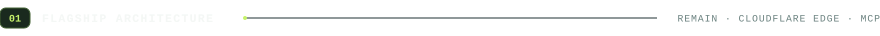
</picture>

  

<a href="https://github.com/scar0x00/remain-monorepo">
  <picture>
    <source media="(prefers-color-scheme: dark)" srcset="./assets/remain-arch-dark.svg" />
    <source media="(prefers-color-scheme: light)" srcset="./assets/remain-arch-light.svg" />
    
  </picture>
</a>

  

  

<a href="https://github.com/scar0x00/remain-monorepo">
  <picture>
    <source media="(prefers-color-scheme: dark)" srcset="./assets/btn-remain-dark.svg" />
    <source media="(prefers-color-scheme: light)" srcset="./assets/btn-remain-light.svg" />
    
  </picture>
</a>

  

<!-- ACT IIIb: SELECTED SYSTEMS (2x2 DOSSIER GRID) -->
<picture>
  <source media="(prefers-color-scheme: dark)" srcset="./assets/section-projects-dark.svg" />
  <source media="(prefers-color-scheme: light)" srcset="./assets/section-projects-light.svg" />
  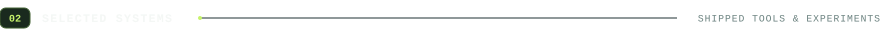
</picture>

  

<a href="https://github.com/scar0x00/finneas">
  <picture>
    <source media="(prefers-color-scheme: dark)" srcset="./assets/project-finneas-dark.svg" />
    <source media="(prefers-color-scheme: light)" srcset="./assets/project-finneas-light.svg" />
    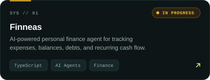
  </picture>
</a>&nbsp;&nbsp;<a href="https://github.com/scar0x00/mywhisper">
  <picture>
    <source media="(prefers-color-scheme: dark)" srcset="./assets/project-mywhisper-dark.svg" />
    <source media="(prefers-color-scheme: light)" srcset="./assets/project-mywhisper-light.svg" />
    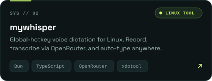
  </picture>
</a>

<a href="https://scar0x00.click">
  <picture>
    <source media="(prefers-color-scheme: dark)" srcset="./assets/project-studio-dark.svg" />
    <source media="(prefers-color-scheme: light)" srcset="./assets/project-studio-light.svg" />
    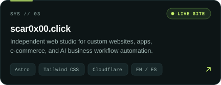
  </picture>
</a>&nbsp;&nbsp;<a href="https://github.com/scar0x00/scar0x00">
  <picture>
    <source media="(prefers-color-scheme: dark)" srcset="./assets/project-profile-dark.svg" />
    <source media="(prefers-color-scheme: light)" srcset="./assets/project-profile-light.svg" />
    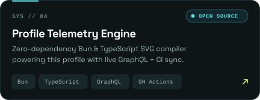
  </picture>
</a>

  

<!-- ACT IV: SYSTEMS & STACK SPECIFICATION MATRIX -->
<picture>
  <source media="(prefers-color-scheme: dark)" srcset="./assets/section-stack-dark.svg" />
  <source media="(prefers-color-scheme: light)" srcset="./assets/section-stack-light.svg" />
  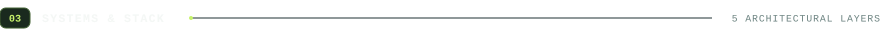
</picture>

  

<picture>
  <source media="(prefers-color-scheme: dark)" srcset="./assets/stack-dark.svg" />
  <source media="(prefers-color-scheme: light)" srcset="./assets/stack-light.svg" />
  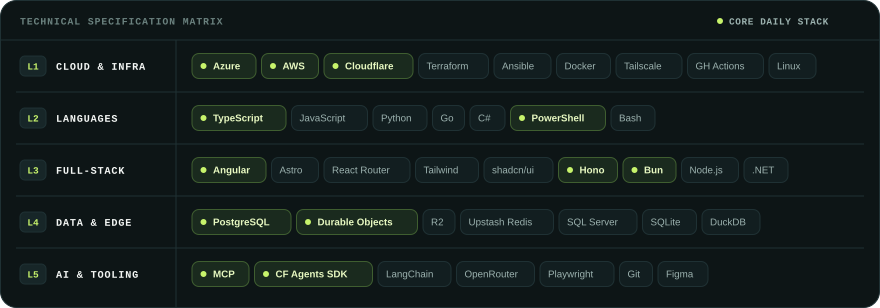
</picture>

  

<!-- ACT V: LIVE TELEMETRY & SIGNAL-LIME CONTRIBUTION SNAKE -->
<picture>
  <source media="(prefers-color-scheme: dark)" srcset="./assets/section-telemetry-dark.svg" />
  <source media="(prefers-color-scheme: light)" srcset="./assets/section-telemetry-light.svg" />
  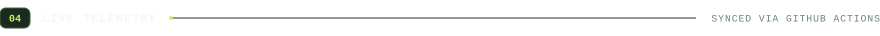
</picture>

  

<!-- Generated every 12h + on push by .github/workflows/update-profile.yml onto the `output` branch -->
<picture>
  <source media="(prefers-color-scheme: dark)" srcset="https://raw.githubusercontent.com/scar0x00/scar0x00/output/telemetry-dark.svg" />
  <source media="(prefers-color-scheme: light)" srcset="https://raw.githubusercontent.com/scar0x00/scar0x00/output/telemetry-light.svg" />
  
</picture>

  

<picture>
  <source media="(prefers-color-scheme: dark)" srcset="https://raw.githubusercontent.com/scar0x00/scar0x00/output/github-contribution-grid-snake-dark.svg" />
  <source media="(prefers-color-scheme: light)" srcset="https://raw.githubusercontent.com/scar0x00/scar0x00/output/github-contribution-grid-snake.svg" />
  
</picture>

  

<!-- ACT VI: SIGNATURE SIGNAL FOOTER -->
<a href="https://scar0x00.click">
  <picture>
    <source media="(prefers-color-scheme: dark)" srcset="./assets/footer-dark.svg" />
    <source media="(prefers-color-scheme: light)" srcset="./assets/footer-light.svg" />
    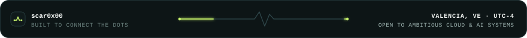
  </picture>
</a>

